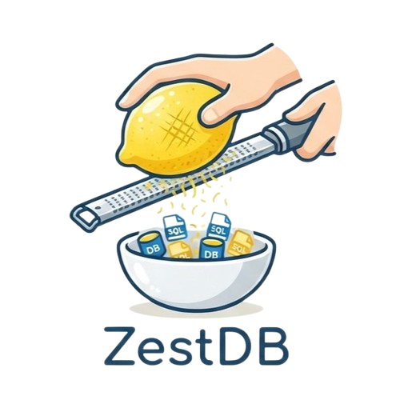

<p align="center">
  
</p>

# ZestDB

ZestDB is a high-performance, disk-persistent key-value store written in modern C++ (C++20).

## Features

- **Key-value commands** on string keys and values: `get`, `set`, `del`, TTL (`setex`, `expire`, `ttl`), atomic `incr`, `setnx` and `cas`, and pattern commands (`getby`, `setby`, `delby`, `count`, `keys`) by prefix, suffix, substring or regex.
- **Durable storage**: 32 shards, each with append-only segments, an in-memory index, an LRU cache and a write-ahead log. Values are zstd-compressed when that makes them smaller, every record and value carries a CRC-32 checksum, and a shard is compacted in the background once half of its data is dead.
- **Lua scripting**: functions called in one round trip and triggers that validate, transform or react to writes, in a sandbox with instruction and memory limits.
- **Network server**: asynchronous TCP with batched commands, optional TLS, per-user roles (`read`, `write`, `admin`) and an IP allow-list.
- **Operations**: hot-reloadable configuration, zip archives with restore, and live per-shard statistics over HTTP.

## Quick start

```bash
make            # builds bin/zestdb; CMake downloads the dependencies
./bin/zestdb    # starts the server (port 7321), the HTTP stats (port 1237) and a REPL
```

Or with Docker:

```bash
docker run -it -p 7321:7321 -p 1237:1237 -v zestdb-data:/data/db benahmedadam/zestdb:latest
```

The image's default configuration has no user account: mount your own `config.yaml` to accept TCP clients (see [Docker](docs/operations.md#docker)).

Then, in the REPL:

```
zestdb> s name "Bob"
{"affectedRows":1,"code":0,"response":""}
zestdb> g name
{"affectedRows":1,"code":0,"response":"Bob"}
zestdb> incr visits
{"affectedRows":1,"code":0,"response":"1"}
```

The provided `config.yaml` has a development account (`bob`/`bob`) and only accepts local connections. Replace the account before opening the server to other addresses.

## Performance

These results are from one run on a single machine, with client and server side by side; there were no errors.

| Workload | Result |
| --- | ---: |
| `set`, batches of 10,000 | ~750k ops/s |
| `get`, cold / hot keys | ~370-470k / ~0.9-1M ops/s |
| 16 concurrent clients, 80% GET | ~600k ops/s |

## Documentation

| | |
| --- | --- |
| [Commands](docs/commands.md) | Every command and its options |
| [Configuration](docs/configuration.md) | `config.yaml`, users and roles |
| [Network protocol](docs/protocol.md) | Framing, authentication, responses |
| [Lua scripting](docs/scripting.md) | Functions, triggers, API ([examples](scripts_examples/)) |
| [Return codes](docs/return-codes.md) | Every response code |
| [Operations](docs/operations.md) | Docker, archives, monitoring, logging |
| [Architecture](docs/architecture.md) | How the storage engine works |
| [Building and testing](docs/building.md) | Dependencies, Windows build, tests, CI, branches |
| [Benchmarks](docs/benchmarks.md) | Full results and how to run them |

## License

See [LICENSE](LICENSE).
