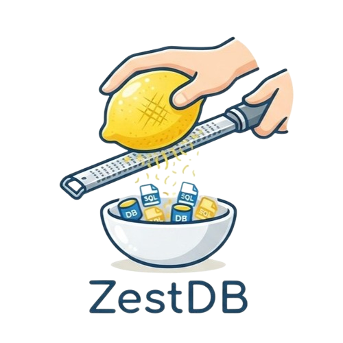

<p align="center">
  
</p>

# ZestDB

ZestDB is a high-performance, disk-persistent key-value store written in modern C++ (C++20).

## Table of Contents

- [Features](#features)
- [Architecture](#architecture)
- [Commands](#commands)
- [Data Storage Model](#data-storage-model)
- [Configuration](#configuration)
- [Network Protocol](#network-protocol)
- [Build](#build)
- [Testing](#testing)
- [Tooling](#tooling)
- [Project Structure](#project-structure)
- [Benchmarks](#benchmarks)
---

## Features

### Core Key-Value Operations
- `set`, `get`, `del` operations on string keys and values, with configurable size limits.
- Case-insensitive command parsing with short aliases (`s`, `g`, `d`).
- Validation of key length (`MaxKeySize`) and value length (`MaxValueSize`).
- Optional `jsonOnly` mode that rejects any value that is not valid JSON.
- `readOnly` mode that blocks all write operations while still allowing reads.

### Bulk / Pattern Operations
- `gb (getBy)`, `sb (setBy)`, ` db (delBy)` commands to query or modify keys that match a user-provided validation rule.
- Four matching modes:
  - `re` - regular expression (ECMAScript syntax via `std::regex`).
  - `sw` - key starts with a given prefix.
  - `ct` - key contains a given substring.
  - `ew` - key ends with a given suffix.
- Optional `lim <n>` parameter to cap the number of affected entries, enforced globally across all shards.
- Bulk operations are executed in parallel across shards and results are merged.

### Sharding
- Data is partitioned over a configurable number of shards (default 32) using `std::hash` on the key.
- Each shard owns its own index, storage segments, LRU cache, WAL and performance counters, allowing independent background maintenance.
- Parallel bulk operations dispatched through an internal thread pool sized to the number of hardware threads.

### Log-Structured Storage
- Values are appended to fixed-size, append-only data segments (`*.seg`).
- When a segment reaches the configured capacity (`SegSize`), a new segment is automatically created (segment rotation).
- Deletes are implemented as tombstones rather than physical removal, keeping the append-only model.
- Unused (fully obsolete) segments are physically removed during compaction.

### In-Memory Index
- An index file maps every key to its location (segment id, offset, size) on disk.
- The index is loaded into an in-memory `unordered_map` for O(1) lookups.
- Updates to an existing key mark the previous index entry as a tombstone and append the new entry, keeping the index append-friendly.
- New and updated entries are always appended (index records are variable-length, so tombstone slots are not reused); compaction reclaims the space.
- Periodic compaction rewrites the index file, dropping all tombstones and unreachable entries.

### LRU Caching
- A per-shard LRU (Least Recently Used) cache stores recently accessed key-value pairs in memory.
- On startup, the cache is pre-filled (warm-up) with the most recently stored entries in the index.
- Cache capacity per shard is configurable via `CacheSize`.
- The cache reports cache-miss ratio per operation type for monitoring.

### Write-Ahead Log (WAL)
- Every successful mutating command is appended to a WAL file, which guarantees durability across unexpected shutdowns.
- Optional `fsyncOnWrite` to force a synchronous fsync after every write.
- On startup, WAL entries are collected, sorted by timestamp, and replayed to rebuild the in-memory state, after which the WAL is cleared.
- The WAL is flushed and cleared together with the index and segments during a flush cycle.

### Durability and Background Maintenance
- A flush thread periodically syncs in-memory changes (index and segments) to disk at a configurable `FlushInterval`.
- A compactor thread per shard runs at a configurable `CompactingInterval` to compact the index and delete unused data segments.
- A verification pass on boot detects and removes index entries that no longer point to valid on-disk data.

### Network Server
- Custom asynchronous TCP server built on Asio, handling multiple concurrent clients with batched commands.
- Batch framing: a single request can carry multiple commands packed with 4-byte length prefixes, with one JSON response per command.
- Per-request JSON output with `code`, `response` and `affectedRows` fields.
- Authentication via a `Authorization: <user>.<sha256(user+password)>` handshake command before any data operation.
- Configurable IP allow-listing using a regular expression (`NetworkValidation`).
- Optional TLS/SSL support (both the TCP server and the HTTP server can use certificates).

### HTTP Monitoring Server
- A separate HTTP server (`WebPort`, default `1237`) exposes live per-shard performance statistics under `/`.
- Statistics include request counts, cache misses, average latency and cache-miss percentage for each operation type (`get`, `set`, `del`, `getby`, `setby`, `delby`) plus an aggregate total.

### Performance Monitoring
- Per-shard, lock-free atomic counters track request counts, cache misses and latency for every operation type.
- Aggregated statistics are exposed through the HTTP server and can be used to observe hot spots or cache efficiency.

### Configuration Management
- All settings are read from a `config.yaml` file with sensible defaults when fields are missing.
- Hot-reload of the configuration via the `reload` / `r` command, with immutability guards on path and port settings.
- Runtime modification of most parameters through the `scfg` command without restarting the server.
- `gcfg` returns the full active configuration as JSON.
- Changes made via `scfg` are persisted back to `config.yaml`.

### Archiving
- The entire database directory can be zipped into a versioned archive stored in a separate `ArchiveStoragePath`.
- Automatic archiving at a configurable `ArchiveCreationDelay` (in seconds), resuming from the most recent archive on restart.
- Manual archiving on demand via the `save` command.
- Can be disabled entirely with `AutoArchiveSaving`.

### Logging
- Multi-level colored logging (`INFO`, `DEBUG`, `WARNING`, `ERROR`, `CRITICAL`) with timestamps.
- Debug level can be enabled/disabled at runtime through the configuration (`isDebug`).

---

## Architecture

ZestDB follows a layered design where each layer is independently testable:

```
                    +---------------------+
   TCP/SSL Server   |  Server / Session   |
                    +---------------------+
                            |
                    +---------------------+
       Command layer        |  ZestDB (execCmd)
                    +---------------------+
                            |
                    +---------------------+
                    |    ShardManager     |   routing + parallel bulk
                    +---------------------+
          +---------------+-----+---------------+
          | Shard 0       | ... | Shard N-1      |
          +---------------+-----+---------------+
          | IndexManager  |  cache-free reads   |
          | StorageManager|  append-only segs   |
          | LRUCache      |  in-memory hot data |
          | WAL           |  durability log     |
          | PerfMonitoring|  metrics            |
          +---------------+-----+---------------+
```

- `ZestDB` is the main facade: it parses commands, applies validation rules, and coordinates shards. It also owns the HTTP server and the background flush/archive threads.
- `ShardManager` routes each key to a shard by hash and parallelizes bulk operations over the thread pool.
- Each `Shard` owns a self-contained storage engine (index, segments, cache, WAL) and a background compactor thread.

### Threading Model
- Main thread: command parsing and dispatch.
- Asio IO threads: network server (TCP/SSL) and HTTP server.
- Per-shard compactor threads: index and segment compaction.
- Global flush thread: periodic disk synchronization.
- Global archive (save) thread: periodic database zipping.
- Thread pool: parallel execution of bulk `getBy`/`setBy`/`delBy` operations.
- Shared-mutex (`shared_mutex`) per shard allows concurrent reads while serializing writes.

---

## Commands

Commands are whitespace-delimited and case-insensitive. For multi-word values, everything after the key/pattern is preserved verbatim.

| Command | Description |
| --- | --- |
| `get <key>` / `g <key>` | Retrieve the value stored for a key. |
| `set <key> <value>` / `s <key> <value>` | Store a value (spaces preserved). |
| `del <key>` / `d <key>` | Delete a key (marks a tombstone). |
| `getby <mode> <pattern> [lim <n>]` / `gb ...` | Get all entries whose key matches the rule. |
| `setby <mode> <pattern> <value> [lim <n>]` / `sb ...` | Update the value of all matching keys. |
| `delby <mode> <pattern> [lim <n>]` / `db ...` | Delete all matching keys. |
| `flush` / `f` | Force all in-memory data to disk and clear the WAL. |
| `reload` / `r` | Reload the configuration from `config.yaml`. |
| `scfg <param> <value>` | Set a configuration parameter at runtime. |
| `gcfg` | Print the full active configuration as JSON. |
| `save` | Manually create a zip archive of the database. |
| `help` / `h` | Print command and usage help. |

### Pattern Modes
- `re` - regex match on the full key.
- `sw` - key starts with the pattern.
- `ct` - key contains the pattern.
- `ew` - key ends with the pattern.
- `lim <n>` - global cap on the number of matched/affected entries.

### Example Session

```
zestdb> s name Bob
{"code":0,"response":"Key successfully set","affectedRows":1}
zestdb> g name
{"code":0,"response":"Bob","affectedRows":1}
zestdb> gb sw na
{"code":0,"response":[{"name":"Bob"}],"affectedRows":1}
zestdb> scfg useSSL true
{"code":0,"response":"Values successfuly updated !","affectedRows":0}
zestdb> d name
{"code":0,"response":"Key successfully deleted","affectedRows":1}
```

### `scfg` Parameters

| Parameter | Type | Notes |
| --- | --- | --- |
| `SegSize` | int | Must be greater than `MaxValueSize`. |
| `MaxKeySize` | int | Cannot exceed the internal limit (256). |
| `MaxValueSize` | int | Must be less than `SegSize`. |
| `CacheSize` | int | Per-shard cache capacity. |
| `CompactingInterval` | int | Seconds between compactions. |
| `FlushInterval` | int | Seconds between disk syncs. |
| `NetworkValidationStr` | string | IP allow-list regex. |
| `isDebug` | bool | Enable debug logging (`true/false` or `1/0`). |
| `useSSL` | bool | Enable TLS on the servers. |
| `jsonOnly` | bool | Reject non-JSON values. |
| `readOnly` | bool | Block write operations. |
| `ArchiveCreationDelay` | int | Seconds between automatic archives. |
| `AutoArchiveSaving` | bool | Enable/disable automatic archiving. |

---

## Data Storage Model

The database directory (`DbPath`) is organized as follows:

```
<DbPath>/
  shards/
    <shard_id>/
      INDEX        # binary index of key -> (segment, offset, size)
      WAL          # write-ahead log of mutating commands
      seg/
        <id>.seg   # append-only value segments
```

### On-disk formats
- **Index**: records serialized as a packed header (`klen`, `offset`, `segmentId`, `size`, `isTombstone`) followed by the key bytes.
- **Segments**: raw concatenated values, referenced by offset and size from the index.
- **WAL**: length-prefixed commands with a millisecond timestamp and a trailing newline, sorted by timestamp on replay.

### Lifecycle
1. A `set` appends the value to the current segment, records an index entry, updates the cache and appends a WAL record.
2. A repeated `set` on the same key tombstones the old index entry and appends the new one.
3. A `del` updates the index entry to a tombstone and evicts the key from the cache.
4. Compaction rewrites the index (removing tombstones) and physically deletes obsolete segments.
5. Flushing fsyncs the index and segments to disk and clears the WAL.

---

## Configuration

Configuration is provided through `config.yaml` in the working directory. All fields are optional and fall back to defaults.

| Key | Default | Description |
| --- | --- | --- |
| `DbPath` | current dir | Folder containing the database files. |
| `SegSize` | 128000 | Maximum size of a data segment (bytes). |
| `MaxKeySize` | 64 | Maximum key length. |
| `MaxValueSize` | 10000 | Maximum value length. |
| `CacheSize` | 1000 | LRU cache capacity per shard. |
| `CompactingInterval` | 3600 | Seconds between compaction runs. |
| `FlushInterval` | 120 | Seconds between disk syncs. |
| `DBPort` | 7321 | TCP data server port. |
| `WebPort` | 1237 | HTTP monitoring server port. |
| `NetworkValidation` | "" | Regex for allowed client IP addresses. |
| `isDebug` | false | Enable debug logging. |
| `jsonOnly` | false | Accept only JSON values. |
| `readOnly` | false | Block write operations. |
| `fsyncOnWrite` | true | Force fsync on every write. |
| `useSSL` | false | Enable TLS on the servers. |
| `SSLCertPath` | "" | Path to the TLS certificate (PEM). |
| `SSLKeyPath` | "" | Path to the TLS private key (PEM). |
| `ArchiveStoragePath` | ./archive/ | Folder where zip archives are written. |
| `ArchiveCreationDelay` | 3600 | Seconds between automatic archives. |
| `AutoArchiveSaving` | true | Enable automatic archiving. |
| `users` | empty | List of `{user, password}` credential pairs. |

---

## Network Protocol

Clients communicate with the TCP server using a length-prefixed, big-endian framing.

### Frame format
```
4 bytes      payload length (network byte order)
N bytes      concatenated commands
```
Each command within the payload is itself length-prefixed:
```
4 bytes      command length (network byte order)
M bytes      command string
```

### Authentication
A session must first send:
```
Authorization: <username>.<sha256(username+password)>
```
The server replies with `{"code":0,...}` on success, or closes the connection on failure. Commands sent before authentication are rejected.

### Response format
Each command yields one JSON object:
```json
{"code":0,"response":"Bob","affectedRows":1}
```
- `code`: `0` on success, `1` on error.
- `response`: a string, or a JSON array/object for bulk operations.
- `affectedRows`: number of affected entries.

Multiple commands in one request are answered with responses separated by `\r\n\r\n` and terminated by a trailing newline. See `test.py` for a full reference client implementation used for stress testing.

---

## Build

### Dependencies
- A C++20 compiler (GCC recommended).
- OpenSSL (`libssl-dev`, `libcrypto`).
- Asio (`libasio-dev`).
- libzippp + libzip, zlib, bzip2, lzma, zstd (for archiving).
- Catch2 (for the test suite).
- The vendored headers in `src/lib/` (httplib, nlohmann/json, fkyaml).

### Compile
```bash
make
```
The resulting binary is placed in `bin/zestdb`.

### Debug build
```bash
make DEBUG=1
```

### Run
```bash
make run            # or ./bin/zestdb
./bin/zestdb pop    # populate a million keys on startup (demo)
```

The process also starts the HTTP monitoring server and an interactive REPL. Type `q` / `quit` to exit gracefully.

---

## Testing

The project ships a test suite built with Catch2, covering every subsystem:

| Area | File |
| --- | --- |
| Data segments | `tests/test_DataSegment.cpp` |
| Index manager | `tests/test_IndexManager.cpp` |
| Storage manager | `tests/test_StorageManager.cpp` |
| Shard | `tests/test_Shard.cpp` |
| Shard manager | `tests/test_ShardManager.cpp` |
| WAL | `tests/test_WAL.cpp` |
| LRU cache | `tests/test_LRUCache.cpp` |
| Thread pool | `tests/test_ThreadPool.cpp` |
| Performance monitoring | `tests/test_PerfMonitoring.cpp` |
| Logger | `tests/test_Logger.cpp` |
| Server protocol | `tests/test_Server_Protocol.cpp` |
| ZestDB commands | `tests/test_ZestDB_Commands.cpp` |
| ZestDB utilities | `tests/test_ZestDB_Utils.cpp` |
| ZestDB validation | `tests/test_ZestDB_Validation.cpp` |

### Run tests
```bash
make tests
```

### Code formatting
```bash
make format
```
Uses `clang-format` with the provided `.clang-format` configuration.

### Continous integration
A GitHub Actions workflow (`c-cpp.yml`) builds the project and runs the full test suite on every push and pull request to `main`.

---

## Project Structure

```
├── Makefile                      # build / test / run / format targets
├── config.yaml                   # runtime configuration
├── .github/workflows/            # CI pipeline
├── src/                          # C++ source
│   ├── ZestDB.{hpp,cpp}          # main facade, commands, config, archiving
│   ├── Server.{hpp,cpp}          # Asio TCP/SSL server and protocol
│   ├── Settings.hpp              # settings, results, messages, validation rules
│   ├── ShardManager.{hpp,cpp}    # shard routing and parallel bulk ops
│   ├── Shard.{hpp,cpp}           # per-shard storage engine + compactor
│   ├── IndexManager.{hpp,cpp}    # in-memory key index
│   ├── StorageManager.{hpp,cpp}  # segment lifecycle management
│   ├── DataSegment.{hpp,cpp}     # append-only value segments
│   ├── LRUCache.{hpp,cpp}        # per-shard LRU cache
│   ├── WAL.{hpp,cpp}             # write-ahead log
│   ├── PerfMonitoring.{hpp,cpp}  # statistics counters
│   ├── ThreadPool.{hpp,cpp}      # parallel task execution
│   ├── Logger.{hpp,cpp}          # multi-level colored logging
│   ├── File.hpp                  # fsync helper
│   ├── main.cpp                  # entry point, REPL, signal handling
│   └── lib/                      # vendored third-party headers
└── tests/                        # Catch2 unit tests
```